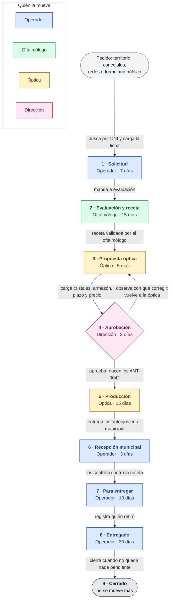
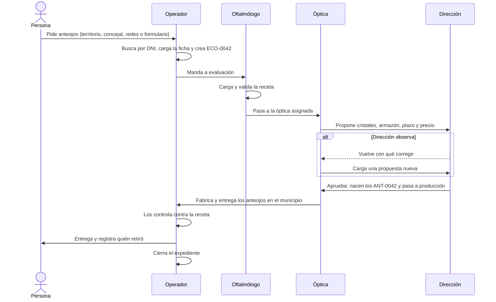

# El circuito del expediente, paso a paso

De la solicitud a la entrega: qué pasa en cada etapa, quién la mueve y qué
controla el sistema antes de dejar pasar. Lo que está acá es lo que hace el
código hoy; las reglas de quién mueve qué viven en
`packages/shared/src/case-flow.ts` y las aplica la API, no la pantalla.

Cada expediente tiene un número, `ECO-0042`, y puede terminar en dos anteojos
con número propio, `ANT-0042`: el de lejos y el de cerca se fabrican y se
entregan por separado.

## El circuito de un vistazo

Cada caja es una etapa; el color dice qué perfil la mueve y la flecha, qué
hace para pasarla a la siguiente.

| # | Etapa | La deja quién | Pasa a | Plazo |
|---|-------|---------------|--------|-------|
| 1 | Solicitud | Operador | Evaluación y receta | 7 días |
| 2 | Evaluación y receta | Oftalmólogo | Propuesta óptica | 15 días |
| 3 | Propuesta óptica | Óptica | Aprobación | 5 días |
| 4 | Aprobación | Dirección | Producción, o vuelve a la óptica | 3 días |
| 5 | Producción | Óptica | Recepción municipal | 15 días |
| 6 | Recepción municipal | Operador | Para entregar | 3 días |
| 7 | Para entregar | Operador | Entregado | 10 días |
| 8 | Entregado | Operador | Cerrado | 30 días |
| 9 | Cerrado | — | — | — |

El administrador puede mover cualquiera de esas etapas, para destrabar cuando
falta alguien. Es la única excepción, y queda registrada igual que todo lo demás.
De "cerrado" no lo mueve nadie.

## Quién le pasa a quién

La misma historia contada desde los perfiles, para ver en qué momento cada uno
recibe el expediente y qué devuelve, sin tener que entrar con cada usuario.

El plazo no frena nada: pasado ese tiempo el expediente aparece marcado en rojo
en la bandeja y cuenta como "fuera de plazo" en los indicadores. Sirve para
saber dónde se está trabando el circuito, no para cerrar casos.

## 1. Solicitud — la carga el operador

El pedido entra por territorio (relevamiento, tráiler, CAC, escuela), por un
pedido individual o de concejales, o por fuera: el panel de redes y el
formulario público. Lo carga un **operador** o **atención de redes**, salvo el
formulario público, que lo carga la propia persona.

Antes de crear una ficha hay que buscar por DNI: si la persona ya fue atendida,
su ficha existe y se reutiliza. Al crearla se pide la fecha de nacimiento (o la
edad, si no la sabe), porque de la edad depende a quién se le entregan después
los anteojos. Se le pueden sacar fotos del DNI, de frente y de dorso, y de la
receta si la persona ya trajo una: las tres son optativas.

Lo que entra por el formulario público queda con **la identidad sin verificar**
hasta que alguien de Salud habla con la persona y la confirma (operador o
atención de redes). El expediente avanza igual, pero los reportes lo señalan.

El operador manda el expediente a evaluación.

## 2. Evaluación y receta — la carga el oftalmólogo

En la jornada, el **oftalmólogo** toma la graduación y carga la receta. Se
escribe como se escribe en la planilla
(`LEJOS OD 180°-3,50 // OI 180°-2,75 - CERCA ADD+1,50 AO`) y el sistema separa
los valores solo, además de deducir si son uno o dos pares.

Un administrativo también puede cargarla, para no frenar la jornada, pero
entonces **queda sin validar**: sólo el oftalmólogo valida. Y una receta sin
validar no pasa a la óptica, el sistema lo rechaza.

Antes de mandarlo a la óptica el expediente tiene que tener una óptica asignada.
Hoy, con una sola óptica activa, se asigna sola al crear el pedido.

## 3. Propuesta óptica — la carga la óptica

La **óptica** carga qué cristales y qué armazón propone, en cuántos días los
entrega y por cuánto. Al cargarla, el expediente pasa solo a aprobación.

Una óptica ve únicamente sus propios expedientes, y sólo mientras están en sus
manos: la API le niega los de otra óptica. En la pantalla del expediente no se le
muestra quién es la persona, y a los reportes no entra.

## 4. Aprobación — la decide Dirección

**Dirección** aprueba la propuesta o la observa. Para observarla hay que escribir
qué corregir: el expediente vuelve a la óptica con ese texto a la vista y queda
marcado "propuesta observada". La óptica carga una versión nueva; las versiones
anteriores no se pisan, quedan todas en el expediente.

Aprobada la propuesta, **ahí recién existen los anteojos**: el sistema le da su
código a cada par, `ANT-0042`, y el expediente pasa a producción.

Dirección aprueba y mide sin ver de quién se trata: no recibe nombres ni DNI en
los reportes, y tampoco ve las fotos del DNI ni la de la receta.

## 5. Producción — la cierra la óptica

La óptica fabrica. Cuando entrega los anteojos en el municipio, marca el
expediente como entregado a la municipalidad.

## 6. Recepción municipal — la controla el operador

Los anteojos están en el municipio pero todavía no se controlaron contra la
receta. El **operador** los controla y los marca listos para entregar. Hasta ese
momento aparecen en Indicadores → Pendientes de entrega bajo "llegaron, falta
controlarlos", separados de los que ya se pueden entregar.

## 7. Para entregar — la entrega el operador

El **operador** registra la entrega: quién retiró, cuándo, y si retiró la propia
persona o alguien en su nombre.

Si la persona es menor de edad (menos de 18), la pantalla ya viene marcada como
"retira el padre, la madre o el tutor" y pide su nombre y su DNI, que quedan en
el expediente como respaldo. Si igual los retira el propio chico se puede, pero
**hay que escribir por qué**, y eso queda escrito. Una ficha sin fecha de
nacimiento ni edad no frena la entrega, pero tampoco afirma que la persona sea
mayor: la pantalla lo dice.

No se puede marcar un expediente como entregado sin registrar antes la entrega.
Al registrarla, los anteojos quedan entregados junto con el expediente, así
buscar por el código del anteojo dice "entregado" y no "en el municipio".

## 8. Entregado y 9. Cerrado

El operador cierra el expediente cuando no queda nada pendiente. Cerrado es el
final del circuito: desde ahí no se mueve a ninguna parte.

## Cuando algo se traba

Un expediente se puede **frenar** sin cerrarlo, con un motivo: falta
documentación, propuesta observada, rechazado, demorado, no se pudo ubicar a la
persona, desistió, reclamo. Frenar no lo saca de la bandeja ni lo cierra, porque
la persona sigue esperando sus anteojos. Mover el expediente a la etapa
siguiente lo destraba solo: el motivo dejó de aplicar.

## Cómo se sigue

- **La bandeja** es la lista de expedientes, filtrable por etapa y por barrio. Se
  busca por número de expediente, por número de anteojo, por apellido o por DNI:
  alcanza con el papelito que tiene la persona.
- **Cada expediente** muestra los días que lleva en la etapa actual, en rojo si
  pasó el plazo, el motivo si está frenado, y el **historial**: cada movimiento
  con quién lo hizo y cuándo.
- **Indicadores** resume lo mismo para todos: cuántos hay en cada etapa, cuántos
  fuera de plazo, por barrio, por canal y por óptica; el padrón de entregas; y
  los pendientes de entrega, anteojo por anteojo, para armar la jornada.
- **La auditoría** registra cada acceso y cada cambio, con quién y cuándo. Ver un
  reporte con nombres, abrir una ficha o abrir una foto del DNI queda registrado
  igual que cambiar algo.

## Quién ve qué

| | Bandeja y expedientes | Nombres en reportes | Foto del DNI | Foto de la receta |
|---|---|---|---|---|
| Operador | Todo | Sí | Sí | Sí |
| Oftalmólogo | Todo | Sí | No | Sí |
| Atención de redes | Todo | Sí | Sí | Sí |
| Óptica | Sólo los suyos, mientras los tiene, sin la identidad en pantalla | No entra a reportes | No | Sí, los suyos |
| Dirección | Todo | No | No | No |
| Administrador | Todo | Sí | Sí | Sí |
